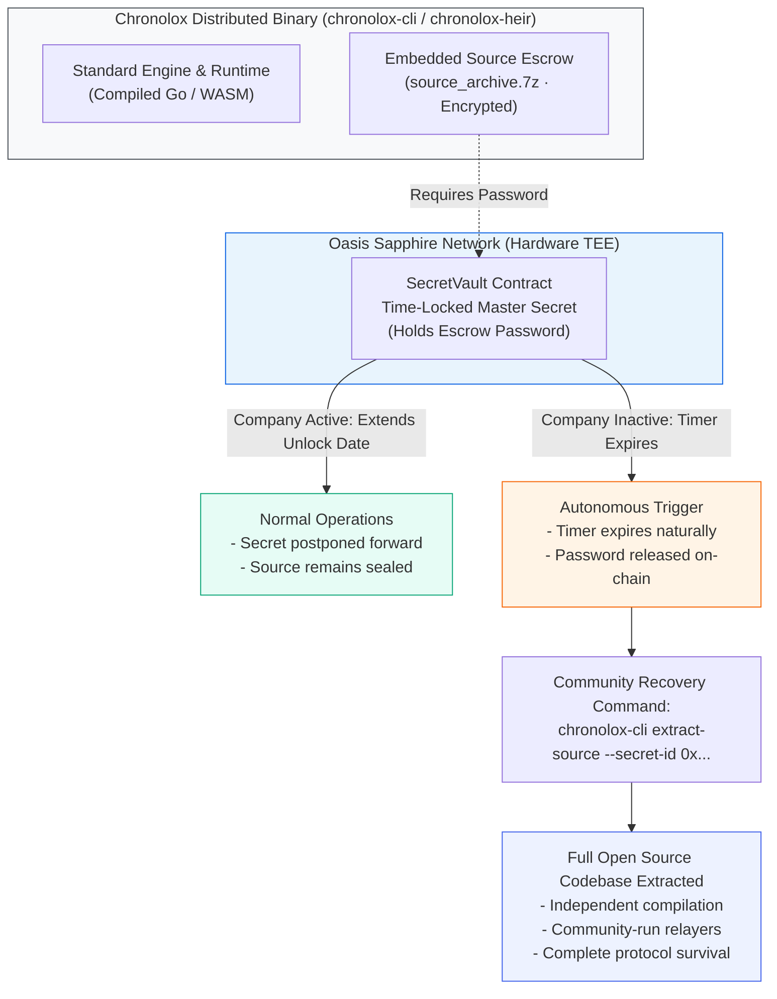

# Chronolox Security Architecture & Source-Code Escrow Specification

**Document Version:** 1.0  
**Target Audience:** Security Auditors, Technical Evaluators, Beta Testers, and Privacy Engineers  
**Classification:** Public Specification  

---

## 1. Executive Security Thesis: The Golden Rule

The foundational axiom of the Chronolox Protocol is:

> **The customer must always be able to retrieve their secrets after the time-lock expires, even if Chronolox as a business completely ceases to exist[cite: 2, 8, 25].**

To fulfill this guarantee, Chronolox abandons traditional centralized SaaS architecture—such as centralized user databases, proprietary auth tokens, and managed secret vaults—in favor of hardware-enforced cryptographic boundaries and public state machines[cite: 2, 7].

---

## 2. Core Cryptographic Model

### 2.1 Hardware-Enforced Custodianship (Oasis Sapphire TEE)
- **Zero Operator Visibility:** Encryption keys are generated, stored, and managed inside hardware-isolated Trusted Execution Environments (TEEs) on the Oasis Sapphire network[cite: 2, 27].
- **Zero Admin Overrides:** No private developer key, governance multisig, or legal demand can force decryption before `block.timestamp >= unlockTime`. Once committed, the contract logic is immutable[cite: 2, 8].
- **Double-Lock Archival (≤ 1 Year):** Short-term and frozen secrets leverage dual custodianship combining Sapphire TEE enclaves with decentralized threshold network beacons (drand `tlock`)[cite: 2, 11, 25]. Even during a total network consensus halt, the payload can be decrypted mathematically offline[cite: 1, 2].

### 2.2 Client-Side Isolation & Calldata Architecture
- **Local Key Derivation:** All payload encryption occurs client-side using authenticated AEAD ciphers (Deoxys-II-256-128 / AES-256-GCM) and Argon2id key derivation before any network packet is dispatched[cite: 2, 6, 27].
- **On-Chain Calldata:** Encrypted payloads are permanently committed into public EVM calldata (Polygon), guaranteeing data availability without depending on private storage servers[cite: 2, 6].
- **Integrity Anchoring:** Document and container fingerprints use quantum-resistant SHA3-512 hashes anchored directly to the public ledger via `ChronoloxNotary.sol`[cite: 6, 11, 29].

---

## 3. Commercial Closed-Source Beta Policy

During the initial deployment and beta validation phases, Chronolox maintains a **source-available, commercial closed-beta distribution model** for its primary application binaries (`secret-maker`, `chronolox-heir`, `chronolox-cli`) and core routing relayers[cite: 1, 15, 28].

### 3.1 Why Is the Code Not Fully Open-Source Yet?
1. **Economic Sustainability:** We are an independent, engineering-driven team bootstrapping protocol development without predatory VC lockups[cite: 2, 9]. Protecting the core implementation during the pre-revenue beta window ensures financial viability and protects early stakeholder equity[cite: 2, 5, 9].
2. **Security by Design, Not by Obscurity:** Chronolox relies strictly on publicly auditable cryptographic primitives (AES-GCM, Argon2id, SHA3-512, Oasis Sapphire TEE, drand)[cite: 2, 6, 27]. The privacy guarantees depend exclusively on mathematics and hardware-isolated enclaves—not on hidden client code[cite: 2, 6].
3. **Audited Milestones:** Core smart contracts and binary components will transition to permissive open-source licenses as operational milestones and economic sustainability are satisfied[cite: 1, 2].

---

## 4. The Cryptographic Dead-Man's Switch for Source Code

To eliminate counterparty risk while source code remains proprietary, Chronolox implements an automated, on-chain **Cryptographic Source Escrow Failsafe** directly inside distributed binaries.



### 4.1 How It Works
1. **Encrypted Source Bundling:** Every official compiled binary (`chronolox-heir`, `chronolox-cli`) contains an embedded, encrypted archive (`source_archive.7z`) containing the complete Go source code, build scripts, and contract definitions.
2. **On-Chain Key Custody:** The decryption password for `source_archive.7z` is stored in an immutable, time-locked secret on the Oasis Sapphire blockchain.
3. **Active Postponement:** While the company is operational, funded, and maintaining the platform, the Chronolox team periodically postpones the unlock date forward via governance transactions.
4. **Autonomous Release on Disappearance:** If Chronolox ever dissolves, ceases business operations, or fails to maintain the protocol, the timer expires naturally. The decryption password unlocks automatically on-chain.
5. **Community Extraction:** Any user with the compiled binary can execute:
   ```bash
   chronolox-cli extract-source --secret-id <PUBLIC_ESCROW_SECRET_ID>

```

The binary queries the blockchain, retrieves the unlocked password, unpacks the entire codebase, and allows the community to audit, self-host, and compile independent relayers and clients indefinitely.

---

## 5. Recipient Verification & Air-Gapped Operation

Heirs do not need network connectivity to inspect or prepare their recovery environments:

* **Portable Standalone Executables:** The Heir Unlocker requires zero external package installations, zero browser dependencies, and zero administrative daemon privileges.
* **Checksum Verification:** Every release published to `github.com/chronolox/releases` is paired with cryptographic checksums (`SHA256SUMS`) signed by the official Chronolox Release Key.
* **Independent On-Chain Verification:** Even if `chronolox.com` is offline, heirs can verify capsule timestamps directly against the Polygon network using any public EVM RPC node.

---

## 6. Responsible Disclosure

If you identify a security vulnerability in our protocol contracts, client cryptography, or binary packages:

1. **Do not open a public GitHub issue.**
2. Send an encrypted report to **`security@chronolox.com`**.
3. Allow up to 48 hours for an initial technical acknowledgement and triage assessment before coordinated disclosure.
